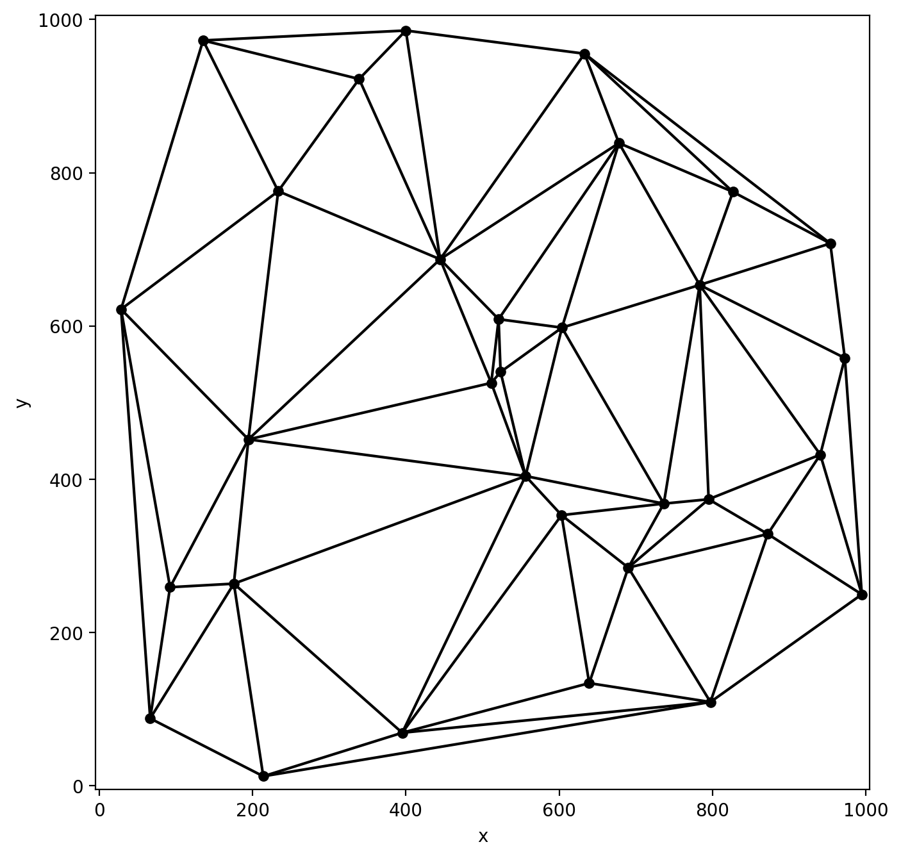
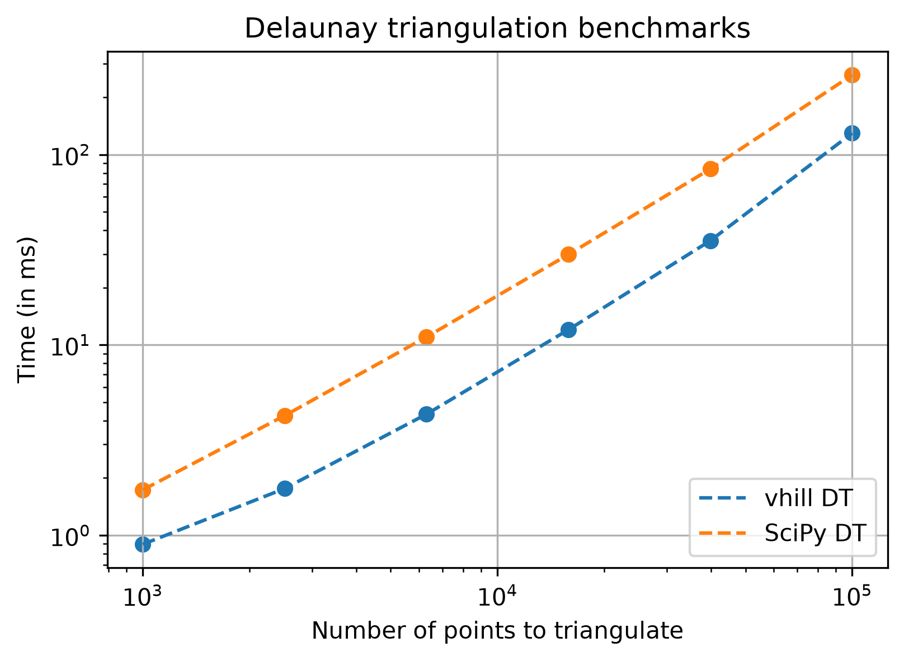

# parallel-delaunay

[Delaunay triangulation](https://en.wikipedia.org/wiki/Delaunay_triangulation) for a 2D point set. On the benchmark below this is about twice as fast as SciPy 1.18.1. Both curves have the same slope: O(*n* log *n*).



```python
from paralleldelaunay import Delaunay

tri = Delaunay(points)
tri.simplices  # (m, 3) indices into the points you passed
```

Points can arrive in any order. `parallel=False` runs one core.

The kernel is [Guibas and Stolfi's](https://doi.org/10.1145/282918.282923) divide-and-conquer algorithm, compiled with Numba. An edge is an index into integer arrays, not an object: `org[e]` is the origin, `onext[e]` is the next edge counterclockwise around that origin, and the symmetric edge is `e ^ 1` because each undirected edge occupies slots `2k` and `2k+1`. `Delaunay` runs every leaf at once, then each round of independent merges, using `prange`.

## Install

Python 3.11 or newer. From the repository root:

```bash
uv sync
```

Another uv project can add the package with `uv add parallel-delaunay`.

## Tests

```bash
make test    # pytest, including a triangle check against SciPy
make format  # Ruff
```

## Benchmark

```bash
uv run python triangulation_benchmarks.py
```

Each time below is the median of five runs against `scipy.spatial.Delaunay`. This library's column includes sorting the points. A ratio below 1 means this library was faster. `parallel_benchmark.py` compares the default `prange` path with `parallel=False`. The 2021 pure-Python chart is `images/Figure 2021-07-02 210145.png`.



| Points | This library | SciPy 1.18.1 | This library / SciPy |
| ---: | ---: | ---: | ---: |
| 1,000 | 0.9 ms | 1.7 ms | 0.5× |
| 2,511 | 1.8 ms | 4.2 ms | 0.4× |
| 6,309 | 4.3 ms | 11.0 ms | 0.4× |
| 15,848 | 12.0 ms | 29.8 ms | 0.4× |
| 39,810 | 35.3 ms | 84.0 ms | 0.4× |
| 100,000 | 129.5 ms | 261.9 ms | 0.5× |

## Reference

Guibas, Leonidas and Stolfi, Jorge. "Primitives for the Manipulation of General Subdivisions and the Computation of Voronoi Diagrams." *ACM Transactions on Graphics* 4.2 (April 1985), pp. 74–123. [doi:10.1145/282918.282923](https://doi.org/10.1145/282918.282923)
